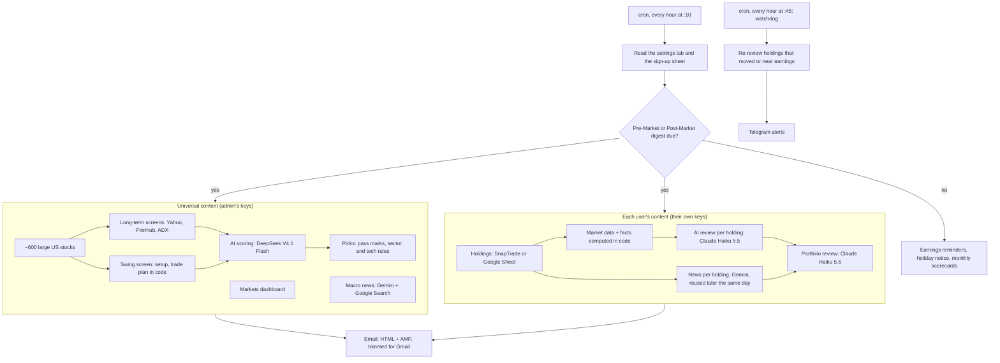

# Finnbot (ai_financial_advisor)

AI-powered assistant that recommends new stocks to explore and alerts you when it's time to sell.

Finnbot emails each user a stock-market digest every trading day, before the open and after the close, and watches their holdings in between, sending a Telegram alert when something needs action. One admin (Andres) runs it for a small group of invited users. Each user pays only for the AI that reviews their own holdings, through their own API keys: about $0.90 to $1.50 a month for 10 holdings.

> Finnbot's signals and ideas are AI-generated opinions from public market data and news. They are not financial advice. Always make your own decisions.

---

## What it does

**The digest** (an email designed for the Gmail app on a phone, with dropdowns so each part can be skipped):

| Section | What's in it |
|---|---|
| Overview | The portfolio's value in the user's home currency, the day's change, unrealized gain or loss, and which positions need attention |
| Risk | A review of the portfolio as a whole (concentration, market sensitivity, earnings clustered together, how much is flagged risky) |
| Markets & macro | Graded market signals (trend, mood from VIX and Fear & Greed, breadth, rates, the dollar, oil) and the day's top macro news with sources |
| Your holdings | One card per stock: price, average cost, gain or loss, its **signal** with the reason, technicals, upcoming earnings, and the news that matters, with links |
| Swing ideas | US stocks set up for a move over the next few weeks, each with an entry, a stop, a target, and the ratio of gain to risk |
| Long-term ideas | US businesses worth owning for years at today's price, with the thesis, the key risk, valuation, growth, and momentum |
| Glossary, costs | The terms that day's email uses; what this digest and the last 30 days cost |

**The five signals** each holding gets, in the order they're checked:

| Signal | Meaning |
|---|---|
| Urgent sell | A specific, time-sensitive problem that can't wait (the only signal that sends a Telegram alert) |
| Profit sell | A real recent run that is showing signs of tiring |
| Risky | Something serious, or two lesser warnings: keep a close eye on it |
| Buy more | Pulled back within a healthy trend, with signs the selling is ending: a time to add |
| Hold | Everything else: healthy, or recovering normally |

**On Telegram:**
- Sell alerts from the watchdog.
- Alerts when a stock bought from a swing idea reaches the idea's stop or target, and a monthly scorecard of how those ideas did against the S&P 500.
- Earnings reminders 24 hours before a held stock reports.
- Notices when a brokerage connection or holdings sheet stops working.

---

## Who it's for, and use cases

**For** individual investors who hold a handful to a few dozen stocks or ETFs (US, Canadian, UK, European, Australian, Colombian listings), want a short twice-daily briefing instead of watching the market, and want ideas screened the same disciplined way every day. Holdings come from a brokerage link (SnapTrade) or a simple Google Sheet, or users can take the ideas only.

**Use cases:**
- **A morning plan and an evening wrap-up:** what moved, why, and what needs attention, before the open and after the close.
- **Watching positions between digests:** hourly price checks, re-reviews when a stock moves a lot or nears earnings, and an alert only when it's urgent.
- **Finding ideas:** about 600 large US stocks screened every day for long-term quality and short-term swing setups, scored by an AI model against a fixed rubric, with an explicit trade plan for each swing idea.
- **Following through on ideas:** a stock bought from an idea is recognized, its plan is tracked, and its outcome is scored.
- **Running it for friends cheaply:** a sign-up form onboards new users, and each one pays a few cents a day on their own keys.

---

## How it works



**The ideas** (shared by everyone):
- **The starting list:** every US-listed stock over a market-cap, volume, and price floor (about 600).
- **Long-term:**
  - screened for quality (analyst coverage, profitability, growth, valuation, debt) and scored out of 100 on valuation, financial health, growth, and competitive moat;
  - **picks:** up to 3 scoring 85 or more, from different sectors, with at most 2 tech stocks and at least 1 outside tech.
- **Swing:**
  - screened for a pullback in a healthy trend or a fresh uptrend, with a trade plan worked out in code, then scored on setup, reward against risk, momentum, and catalysts;
  - **picks:** up to 5 scoring 75 or more that are still early in their move.
- **Close calls:** a score near the bar is scored again, and the middle score is kept.

**The holdings** (per user):
- **Facts first:** code works out each holding's facts (trend, pullback or run, signs of a turn, stretched, days to earnings, fund or not).
- **Then the review:** Claude Haiku 5.5 applies the rubric above in order.
- **Second looks:** an urgent sell or profit sell is reviewed twice more, and the majority wins, so a one-off reading can't send an alert.

Plain-language details for users: [docs/new_user_guide.txt](docs/new_user_guide.txt), sections 8 and 9. Technical details: [docs/watchdog.md](docs/watchdog.md).

---

## Automations

| Job | When | What it does |
|---|---|---|
| Digest run | Every hour at :10 (cron) | Syncs settings and users, then sends the Pre-Market digest (from 07:00 ET until the open) or the Post-Market digest (16:10 ET, retried for 4 hours) when due. Also sends earnings reminders, the US-holiday notice, and the monthly idea scorecards. |
| Watchdog | Every hour at :45 | For users with Telegram: re-reviews holdings that moved about a day's range, report within 7 days, or have reviews over 24 h old. An hourly tripwire catches bigger moves. At most 40 reviews per user per day. |
| Settings sync | Every digest run | Applies valid changes from the **Parameters** tab of the sign-up spreadsheet; a change in `parameters.py` wins over the tab. |
| Sign-up sync | Every cron digest run | Imports new or edited sign-up form answers into `.env` and the list of active users. |
| Backup | 02:30 UTC daily | Encrypted copy of the state to Google Drive (90 days of versions), plus the run logs. |
| Heartbeat | Every job | Pings healthchecks.io, which alerts on Telegram when a job fails, hangs, or doesn't run. |
| Failure alerts | When something breaks | The admin gets a Telegram message (once per problem per 6 hours); users see what went wrong at the top of their email. |

---

## Models and costs

| Job | Model | Paid by |
|---|---|---|
| Idea scoring | DeepSeek V4.1 Flash (high effort) | Admin |
| Macro news | Gemini 3.6 Flash with Google Search (low thinking) | Admin |
| Holdings reviews and the portfolio review | Claude Haiku 5.5 (low effort) | Each user (Anthropic key) |
| News for each holding | Gemini 3.6 Flash with Google Search (low thinking, 3 holdings per request) | Each user (Gemini key; only with news on) |

Each model was chosen in a side-by-side comparison against Claude Opus 5.5 ([docs/model_selection.md](docs/model_selection.md)).

**Per user, per month** (21 trading days; estimates at October 2026 prices; the watchdog adds about $0.20-0.50 for 10 holdings):

| Digests a day | Holdings | News off | News on |
|---|---|---|---|
| 1 | 10 | $0.45 | $0.87 |
| 2 | 10 | $0.90 | $1.43 |
| 2 | 20 | $1.74 | $2.79 |

The full table, per stock per run included, is in the user guide (3.10). Gemini's prices double on 2027-01-01, which roughly doubles the news cost. An ideas-only user pays nothing.

**Admin:**
- **The shared part:** about $0.17 per digest (mostly the idea scoring), so about $7 a month.
- **Hosting:** the VM is planned on Google Cloud's free e2-micro (about $12 a month if a bigger machine turns out to be needed; see [docs/vm_setup.md](docs/vm_setup.md)).
- **Measured, not guessed:** every API call's cost is recorded in `data/usage/api_usage.jsonl` and shown at the bottom of each digest.

---

## Usage

**Requirements:**
- Python 3.14 and the packages in `requirements.txt` (`requirements-dev.txt` adds pytest);
- a Google Cloud service account (for the Google Sheets);
- a Gmail account to send from;
- a Telegram bot;
- API keys: Anthropic and/or DeepSeek, Gemini, Finnhub, FRED, and Twelve Data (optional).

**Set up:**
```bash
python -m venv venv && venv/bin/pip install -r requirements-dev.txt   # or uv; Windows: venv\Scripts\...
cp .env.example .env                                                   # then fill it in (never commit it)
venv/bin/python -m src.config.check_config                                    # reports anything missing or invalid
```

**Run** (all commands and options: [docs/admin_handbook.md](docs/admin_handbook.md), section 1):

| Command | Does |
|---|---|
| `venv/bin/python src/digest/digest_payload.py` | The scheduled digest run (what cron calls) |
| `... --payload-only --period Post-Market` | Builds a digest now with live data and saves it, without emailing anyone |
| `... --from-payload test_output/digest_payloads/<file>.json` | Emails a saved digest as a `[Test]` |
| `... --check` | Says whether a digest is due and for whom |
| `venv/bin/python src/telegram_alert/hourly_watchdog.py --dry-run` | Shows what the watchdog would check |
| `venv/bin/python -m src.config.remote_settings --sync` | Applies the Parameters tab now |
| `venv/bin/python -m src.users.import_signup --sync` | Imports the sign-up form's answers now |
| `venv/bin/python -m pytest` | The tests |

**Deploy:** [docs/vm_setup.md](docs/vm_setup.md) has the step by step for a Google Cloud VM, plus monitoring and backups.

### Adding a user

Through the sign-up form (built by [docs/finnbot_signup_form.gs](docs/finnbot_signup_form.gs), explained in [docs/new_user_guide.txt](docs/new_user_guide.txt)):
1. The new user fills in the form and sends their API keys privately, never in the form.
2. Each cron digest run applies every user's newest answer to `.env`, and puts the users with nothing required missing in `ACTIVE_USERS`.
3. A key a user's choices need but hasn't arrived yet is written as `KEY=None`. Replace it with the key they send (`python -m src.users.import_signup <Name> --enter-keys` takes it with hidden input), and the next run activates them.
4. The admin hears about each sign-up, activation, and deactivation on Telegram.

Without the sheet: add the name to `ACTIVE_USERS` in `src/config/parameters.py`, print the `.env` lines to fill in with `python -m src.config.check_config --template <Name>`, then run `python -m src.config.check_config`.

---

## Configuration

Three layers, the last one winning:
1. **`src/config/parameters.py`:** every setting and its default, commented with why it has its value.
2. **The Parameters tab** of the sign-up spreadsheet: one row per setting, with Finnbot's status and a note on what it does. Changes there are checked and apply from the next digest run, without editing code. A later change in `parameters.py` wins over the tab.
3. **`.env`:** secrets, per-user settings (written by the sign-up sync), and an optional per-machine override of the ideas' model.

---

## Repository layout

```
src/
  config/                   Settings
    parameters.py               All settings and their defaults
    settings_overrides.py       Applies the Parameters tab's accepted values at import
    remote_settings.py          Syncs the Parameters tab (read, check, write the status back)
    parameter_notes.py          The "What it does" note for each setting
    check_config.py             Checks .env
  users/                    Who uses Finnbot
    import_signup.py            The sign-up form → .env and ACTIVE_USERS
    admins.py                   Who the admins are, and how notices are worded for everyone else
  llm/                      The AI models
    llm_models.py               Which model does which job, and its provider
    deepseek_client.py          DeepSeek requests and answer repair
    gemini_settings.py          Gemini's thinking level and output cap for every call
  market/                   Market time and money
    market_session.py           Exchange calendars and sessions
    fx_rates.py                 Exchange rates to USD
  tracking/                 What Finnbot recommended and spent
    track_record.py             How past signals and ideas played out
    idea_positions.py           Holdings bought from ideas: labels, alerts, scorecards
    usage_tracking.py           Tokens and cost of every API call
  ops/                      Running it
    run_logging.py              Run logs and crash alerts
    shared_locks.py             The lock around the shared market-data keys
  universal/                The shared content
    universal_consolidated.py   Screens, scoring, picks, dashboard, macro news
    recommendations/            Stage filters, swing screen, LLM rubric and scoring, picks
    macro_indicators.py, market_news.py
  personalized/             Each user's content
    pull_holdings_data.py       Holdings from SnapTrade or a Google Sheet, prices, FX
    holding_checks.py           Facts computed in code for the review
    recommendation.py, LLM_hold_instr.py   The holdings review and its rubric
    symbol_specific_news.py, news_reuse.py, portfolio_review.py
  digest/                   Scheduling, the email (create_html.py, email_template.html), sending
  telegram_alert/           Watchdog, notices, earnings reminders, holiday notice
scripts/                    The cron wrapper (healthchecks.io pings), the Drive backup, a cron test
docs/                       Guides (below), and the sign-up form's Apps Script
tests/                      About 380 offline tests
```

At the top level: `requirements.txt` / `requirements-dev.txt`, `pytest.ini`, `.env.example` (every key `.env` takes), and `CONVENTIONS.md` (coding rules).

Runtime state lives in `data/` and logs in `logs/`. Both are gitignored, since they contain users' holdings.

---

## Documentation

| Doc | For | What's in it |
|---|---|---|
| [docs/new_user_guide.txt](docs/new_user_guide.txt) | New users | Every choice, what it costs, how to get each key, Gmail setup, how ideas and holdings work, keeping keys safe |
| [docs/admin_handbook.md](docs/admin_handbook.md) | The admin | Every command and option, the pipeline, Telegram messages, settings, onboarding, files, troubleshooting |
| [docs/vm_setup.md](docs/vm_setup.md) | The admin | Moving Finnbot to a Google Cloud VM, step by step |
| [docs/operations.md](docs/operations.md) | The admin | healthchecks.io monitoring and the Google Drive backup |
| [docs/watchdog.md](docs/watchdog.md) | Developers | The full technical reference: every setting, file, and design decision |
| [docs/model_selection.md](docs/model_selection.md) | Developers | How the models and efforts were compared and chosen |

---

## Data, privacy, and security

- **API keys and passwords** live only in `.env` (gitignored) and in each user's password manager. Users send them privately, never through the form.
- **What goes where:**
  - a user's holdings go to Anthropic for the reviews;
  - only symbols and company names go to Gemini for the news;
  - SnapTrade, when used, reads the brokerage positions read-only;
  - the idea screens use public market data only.
- **Backups** of the state are encrypted before they reach Google Drive.
- **Tests** call no real API and write only to temporary folders (`python -m pytest`).

---

## Status

Running on Andres's PC; the move to a Google Cloud VM ([docs/vm_setup.md](docs/vm_setup.md)) is next, followed by the healthchecks.io heartbeat and the Drive backup on that VM. Until then, nothing runs on a schedule.
